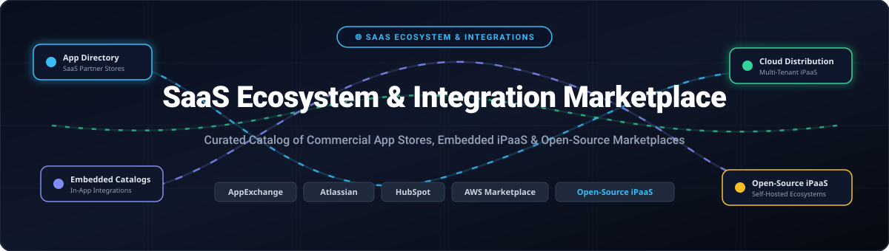

# Awesome SaaS Ecosystem & Integration Marketplace

  

  <strong>A curated directory of SaaS Ecosystem platforms, cloud application stores, embedded integration catalogs, and open-source integration marketplaces.</strong>

  
  
  
  

---

## 📑 Table of Contents

- [Sector Overview & Market Dynamics](#-sector-overview--market-dynamics)
- [SaaS / Hosted Platforms](#-saas--hosted-platforms)
- [Open-Source Software](#-open-source-software)
- [Comparison at a Glance](#-comparison-at-a-glance)
- [Key Selection Criteria](#-key-selection-criteria)
- [Contributing](#-contributing)
- [License](#-license)

---

## 🌐 Sector Overview & Market Dynamics

The global cloud micro-services, embedded iPaaS, and digital B2B application marketplace sector is estimated at **$18.5 Billion in 2024**, projected to reach **$85.2 Billion by 2032** growing at a CAGR of **21.4%**. 

The market dynamics exhibit a **highly concentrated, winner-take-most structure at the hyper-scaler and system-of-record layer** (dominated by AWS, Salesforce, Google, and Microsoft where network effects and buyer commit draws lock in ecosystems), while remaining **moderately fragmented in embedded integration platforms and vertical developer tooling**, where modular API connectors and open-source alternatives are competing for product-led integration workflows.

---

## 🟦 SaaS / Hosted Platforms

Below is the structured overview of leading SaaS ecosystem and application marketplace platforms, sorted in descending order by company valuation / annual revenue.

| Platform | Parent Company / Developer | Market Valuation / Revenue | Starting Pricing Tier | Free Tier & Free Trial Limits | Key Marketplace Focus |
|:---|:---|:---|:---|:---|:---|
| **[AWS Marketplace](https://aws.amazon.com/marketplace)** | Amazon (NASDAQ: AMZN) | **~$2.1 Trillion Market Cap** ($575B+ Annual Rev) | Pay-per-use / $0.01+/hr per software listing; seller listing fee varies by contract (typically 1.5%–3% listing fee on AWS Marketplace Private Offers) | **AWS Free Tier (12 Months Free)** + 7 to 30-day free software trials (vendor-specific AMI/SaaS limits apply) | Cloud infrastructure, dev tools, and enterprise procurement |
| **[Google Workspace Marketplace](https://workspace.google.com/marketplace)** | Alphabet (NASDAQ: GOOGL) | **~$2.0 Trillion Market Cap** ($307B+ Annual Rev) | Free to browse; Google Workspace starts at $6.00/user/month (Business Starter); $0 developer registration fee | **14-day free trial** for Google Workspace Business tiers (up to 10 users); thousands of permanently free add-ons | Productivity add-ons, Gmail/Docs plugins, CRM connectors |
| **[Slack App Directory](https://slack.com/apps)** | Salesforce / Slack (NYSE: CRM) | **~$300 Billion Market Cap** (Slack acquired for $27.7B; Salesforce $34.9B Rev) | Slack Pro starts at $7.25/active user/month (billed annually); directory listing is free for approved apps | **Free forever plan** with limits of up to 10 app integrations, 90 days message history, and 1:1 huddles | Team communication, bot notifications, and automated workflows |
| **[Salesforce AppExchange](https://appexchange.salesforce.com/)** | Salesforce Inc. (NYSE: CRM) | **~$300 Billion Market Cap** ($34.9B Annual Rev) | Salesforce Starter Suite starts at $25.00/user/month; AppExchange ISV partner program starts at $2,500/year checkout fee + 15% revenue share | **30-day free trial** of Salesforce Starter Edition (full CRM features, up to 10 users); extensive catalog of free partner apps | Enterprise CRM extensions, AgentExchange AI, ISV solutions |
| **[Shopify App Store](https://apps.shopify.com/)** | Shopify Inc. (NYSE: SHOP) | **~$110 Billion Market Cap** ($7.06B Annual Rev) | Basic Shopify starts at $29.00/month (billed annually); partner listing fee is 0% rev share on first $1M/year (then 15%) | **3-day free trial** followed by $1/month for the first 3 months; app-level trials vary (typically 7-14 days free trial) | E-commerce plugins, storefront extensions, checkout ops |
| **[ServiceNow Store](https://store.servicenow.com/)** | ServiceNow Inc. (NYSE: NOW) | **~$190 Billion Market Cap** ($8.97B Annual Rev) | Custom enterprise contracts starting at ~$100.00/user/month for IT Service Management (ITSM); Store partner fee ~$5,000/year | **Personal Developer Instance (PDI)** free forever for developers (auto-reclaimed if inactive for 10 days); 30-day app trial | Enterprise IT service workflows, ITSM plugins, HR delivery |
| **[Atlassian Marketplace](https://marketplace.atlassian.com/)** | Atlassian Corp (NASDAQ: TEAM) | **~$45 Billion Market Cap** ($4.36B Annual Rev) | Jira Cloud Standard starts at $7.55/user/month; Marketplace apps billed per user or free tier | **Free forever plan** for up to 10 users on Jira & Confluence; 30-day full-feature free trial for all paid Marketplace apps | DevOps, issue tracking, agile project management apps |
| **[HubSpot App Marketplace](https://ecosystem.hubspot.com/marketplace/apps)** | HubSpot Inc. (NYSE: HUBS) | **~$28 Billion Market Cap** ($2.17B Annual Rev) | Free CRM tools available; Marketing Hub Starter starts at $15.00/seat/month; partner listing is free upon certification | **Free forever plan** (Free CRM tools with limit of 1,000,000 contacts, core form & email limits); 14-day trial for Professional tiers | CRM sync, inbound marketing tools, lead capture |
| **[Zendesk Marketplace](https://www.zendesk.com/marketplace/)** | Zendesk (Acquired by Hellman & Friedman) | **~$10.2 Billion Valuation** (Acquisition price) | Zendesk Support Team starts at $19.00/agent/month (billed annually); Marketplace listings free for approved developers | **14-day free trial** of Zendesk Suite Professional (full access, 5 agent licenses included during trial) | Customer service ticketing apps, custom objects, telephony |
| **[Freshworks Marketplace](https://www.freshworks.com/apps/)** | Freshworks Inc. (NASDAQ: FRSH) | **~$4.5 Billion Market Cap** ($596M Annual Rev) | Freshservice Starter starts at $19.00/agent/month (billed annually); Connector Apps charged on task packs ($100/5,000 tasks) | **14-day free trial** (unlimited access to Starter/Growth features); Free Starter plan for Freshdesk (up to 10 agents) | IT service management, omnichannel CRM, HR connector recipes |

---

## 🟩 Open-Source Software

Self-hosted, community-driven integration marketplaces, embedded iPaaS catalogs, and extensible workflow frameworks. Sorted in descending order by GitHub stargazers.

### 1. n8n

- **Repository:** [n8n-io/n8n](https://github.com/n8n-io/n8n)
- **Stack:** TypeScript, Node.js, Vue.js, SQLite/PostgreSQL, Docker
- **License:** Fair-code (Sustainable Use License) / Apache-2.0 community components
- **Description:** A leading extensible workflow automation and integration platform with a rich node marketplace (400+ built-in connectors). Features native LangChain AI agents, multi-tenant execution, and an active community registry of custom integration nodes.
- **Best For:** Self-hosted workflow automation with an extensive visual integration catalog and AI pipeline triggers.

### 2. Huginn

- **Repository:** [huginn/huginn](https://github.com/huginn/huginn)
- **Stack:** Ruby on Rails, MySQL/PostgreSQL, JavaScript
- **License:** MIT License
- **Description:** An open-source system for building automated agents that monitor online services, parse web feeds, and execute actions when events trigger. Often dubbed a hackable, self-hosted IFTTT/Zapier alternative with a modular agent architecture.
- **Best For:** Developer-centric web scraping, scheduled data pipelines, and personal automation ecosystems.

### 3. Activepieces

- **Repository:** [activepieces/activepieces](https://github.com/activepieces/activepieces)
- **Stack:** TypeScript, Node.js, Angular, PostgreSQL, Docker
- **License:** MIT License
- **Description:** An open-source, no-code workflow automation tool designed with an embeddable architecture. Provides an embedded software development kit (SDK) to let SaaS platforms natively offer an integration marketplace inside their own web apps.
- **Best For:** SaaS product builders wanting to embed a clean, user-friendly integration store and workflow builder for their customers.

### 4. Node-RED

- **Repository:** [node-red/node-red](https://github.com/node-red/node-red)
- **Stack:** JavaScript, Node.js, HTML5
- **License:** Apache-2.0
- **Description:** A low-code flow-based development environment backed by OpenJS Foundation. Offers the **Node-RED Flow Library**, an open ecosystem and community marketplace containing over 4,000 modular nodes and reusable integration packages.
- **Best For:** Event-driven IoT, edge orchestration, and hardware-to-cloud API integrations.

### 5. Airbyte

- **Repository:** [airbytehq/airbyte](https://github.com/airbytehq/airbyte)
- **Stack:** Java, Python, TypeScript, Docker, Kubernetes
- **License:** ELv2 (Connector marketplace under MIT)
- **Description:** The leading open-source data integration engine featuring an extensible connector marketplace with 350+ pre-built connectors. Enables bidirectional sync and ELT pipelines across databases, SaaS APIs, and data warehouses.
- **Best For:** High-volume data synchronization and custom ELT integration catalogs.

### 6. Automatisch

- **Repository:** [automatisch/automatisch](https://github.com/automatisch/automatisch)
- **Stack:** JavaScript, Node.js, React, PostgreSQL
- **License:** AGPL-3.0
- **Description:** A privacy-first, self-hosted Zapier alternative that keeps sensitive business data stored entirely on local infrastructure. Offers built-in app connectors without cloud telemetry dependencies.
- **Best For:** Privacy-regulated industries (HIPAA, GDPR) requiring on-premises integration catalogs.

### 7. Apache Camel

- **Repository:** [apache/camel](https://github.com/apache/camel)
- **Stack:** Java, Enterprise Integration Patterns (EIP)
- **License:** Apache-2.0
- **Description:** The enterprise-grade open-source integration framework implementing standard Enterprise Integration Patterns. Features 300+ components (Camel K, Camel Karavan low-code UI) for building scalable enterprise marketplace backbones.
- **Best For:** Large-scale enterprise messaging, mission-critical bus architectures, and hybrid cloud backbones.

### 8. Panora

- **Repository:** [panoratech/Panora](https://github.com/panoratech/Panora)
- **Stack:** TypeScript, Node.js, PostgreSQL, Redis, Docker
- **License:** AGPL-3.0
- **Description:** An open-source unified API and embedded integration catalog engine (Merge.dev alternative). Enables SaaS platforms to ship CRM, ticketing, accounting, and messaging integrations through a single unified schema and embedded UI.
- **Best For:** SaaS startups wanting an out-of-the-box embedded integration store and unified API for customer-facing integrations.

### 9. Cenit IO

- **Repository:** [cenit-io/cenit](https://github.com/cenit-io/cenit)
- **Stack:** Ruby, MongoDB, Docker
- **License:** MIT License
- **Description:** An open-source iPaaS platform designed for orchestrating business data protocols (EDI, REST, SOAP) with a shared directory of community-contributed integration algorithms and data schemas.
- **Best For:** Supply chain, logistics, and multi-protocol B2B data translation.

### 10. World Vibe Web (WVW)

- **Repository:** [onelifefyi/WorldVibeWeb](https://github.com/onelifefyi/WorldVibeWeb)
- **Stack:** Tauri, Rust, Static Site
- **License:** MIT / Open Source
- **Description:** A federated, decentralized app directory for indie open-source applications. Removes centralized review queues and commission cuts by allowing developers to publish through repository-hosted metadata schemas.
- **Best For:** Decentralized open-source software discovery without gatekeepers.

---

## 📊 Comparison at a Glance

| Solution | Deployment Model | Open Source | Embedded Catalog SDK | Multi-Tenant Architecture | Primary Use Case |
|:---|:---|:---:|:---:|:---:|:---|
| **AWS Marketplace** | Hosted Cloud | ❌ | Proprietary API | ✅ | Cloud infrastructure, AMIs & SaaS procurement |
| **Salesforce AppExchange** | Hosted Cloud | ❌ | Native Canvas / LWC | ✅ | Enterprise CRM & AgentExchange apps |
| **Google Workspace Marketplace**| Hosted Cloud | ❌ | Google Add-on API | ✅ | Productivity suite & collaboration add-ons |
| **Shopify App Store** | Hosted Cloud | ❌ | App Bridge SDK | ✅ | Merchant e-commerce tools & payment apps |
| **Atlassian Marketplace** | Hosted Cloud | ❌ | Forge / Connect SDK | ✅ | Jira & Confluence engineering extensions |
| **HubSpot App Marketplace** | Hosted Cloud | ❌ | CRM UI Extensions | ✅ | Sales, marketing, and customer service sync |
| **Zendesk Marketplace** | Hosted Cloud | ❌ | Zendesk Apps Framework (ZAF)| ✅ | Customer support ticketing workflows |
| **Freshworks Marketplace** | Hosted Cloud | ❌ | Freshworks CLI (FDK) | ✅ | IT and employee service connector recipes |
| **Activepieces** | Self-Hosted / Cloud | ✅ (MIT) | ✅ Native SDK | ✅ | Embedded integration marketplace for SaaS |
| **n8n** | Self-Hosted / Cloud | ✅ (Fair-code)| Custom Nodes / Embed | ✅ | Advanced workflow automation with AI agents |
| **Panora** | Self-Hosted / Cloud | ✅ (AGPL-3.0)| ✅ White-label UI | ✅ | Unified API & customer integration catalog |
| **Node-RED** | Self-Hosted | ✅ (Apache-2.0)| Flow Embed Library | ❌ | Event-driven visual IoT and API flows |
| **Airbyte** | Self-Hosted / Cloud | ✅ (ELv2/MIT) | Embedded API | ✅ | High-throughput data replication & ELT |
| **Automatisch** | Self-Hosted | ✅ (AGPL-3.0)| ❌ | ❌ | Privacy-compliant on-premises automation |
| **Apache Camel** | Self-Hosted Library| ✅ (Apache-2.0)| Karavan UI | ❌ | Enterprise message routing & integration bus |
| **Cenit IO** | Self-Hosted / Cloud | ✅ (MIT) | Data Integrator Hub | ✅ | Open-source iPaaS with multi-protocol support |
| **World Vibe Web** | Decentralized Client| ✅ (Open Source)| Static Registry Schema | ❌ | Federated app store for open-source tools |

---

## 🔍 Key Selection Criteria

When deciding between hosted commercial ecosystems and open-source embedded marketplaces, consider:

1. **Ecosystem Reach vs. Custom Brand Control:**
   - Commercial app stores (Salesforce, Shopify, Google) give instant access to millions of existing active business buyers, but require adherence to compliance gatekeeping and revenue share fees.
   - Embedded engines (Activepieces, Panora) allow SaaS products to offer native 1-click integrations inside their own application UI under their own brand.
2. **Data Privacy & Compliance (HIPAA, GDPR, On-Premises):**
   - For internal automations dealing with sensitive PII or air-gapped environments, self-hosted open-source solutions like Automatisch, n8n, or Apache Camel eliminate third-party data leakage risks.
3. **Monetization & Commission Models:**
   - Hyper-scaler stores charge transaction fees or require certified partner subscriptions ($2,500+).
   - Open-source platforms eliminate listing commissions, allowing direct billing between SaaS vendors and their customers.

---

## 📈 Star History

---

## 🤝 Contributing

Contributions are welcomed! If you maintain or use an open-source SaaS ecosystem platform, embedded marketplace SDK, or integration tool that belongs on this list:

1. Fork this repository.
2. Create a new branch: `git checkout -b add-my-integration-tool`.
3. Add your tool to the relevant section adhering to alphabetical or star-ranked ordering.
4. Ensure you include repository link, license, tech stack, and clear standout features.
5. Submit a pull request with a descriptive title.

---

## 📄 License

This repository and curated list are released under the [Creative Commons Zero v1.0 Universal](LICENSE) (CC0 1.0) Public Domain Dedication. Software and trademarks mentioned remain property of their respective owners.
